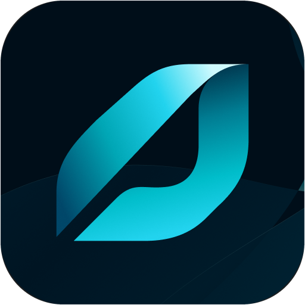
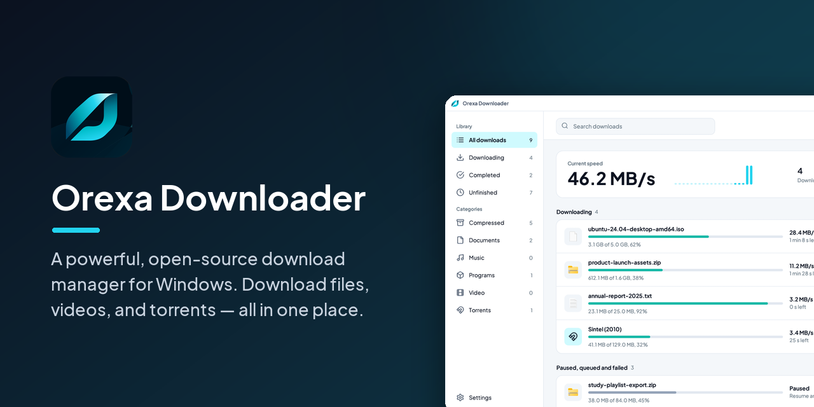
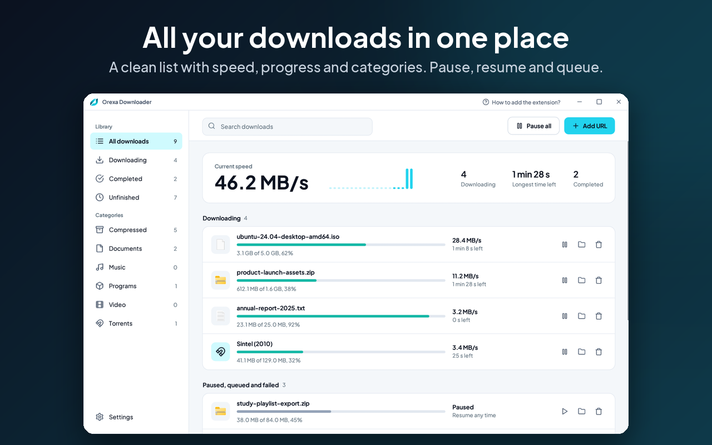
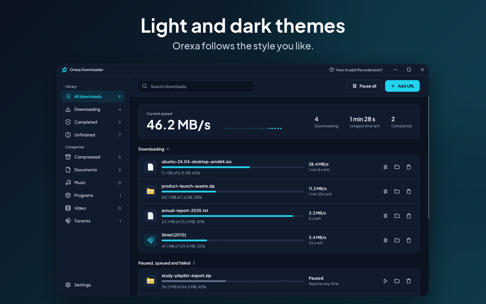
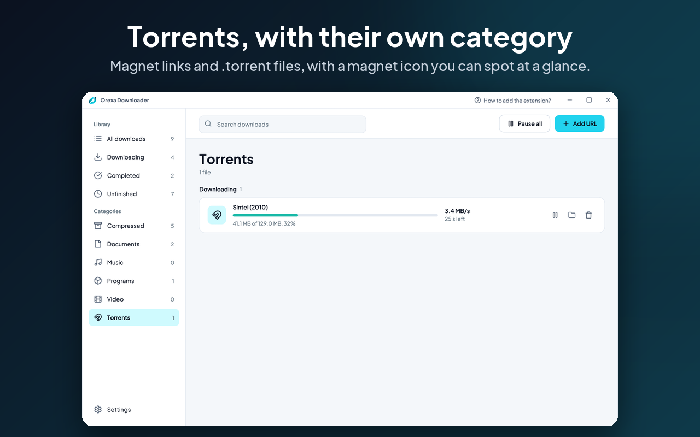
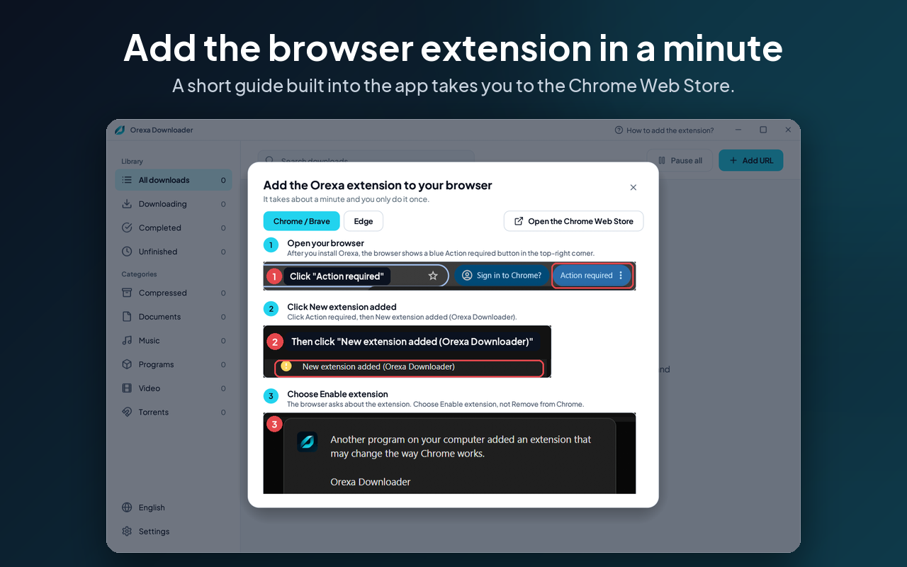
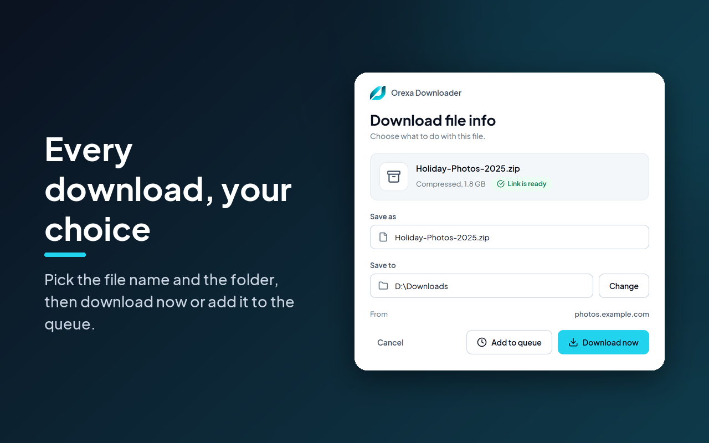
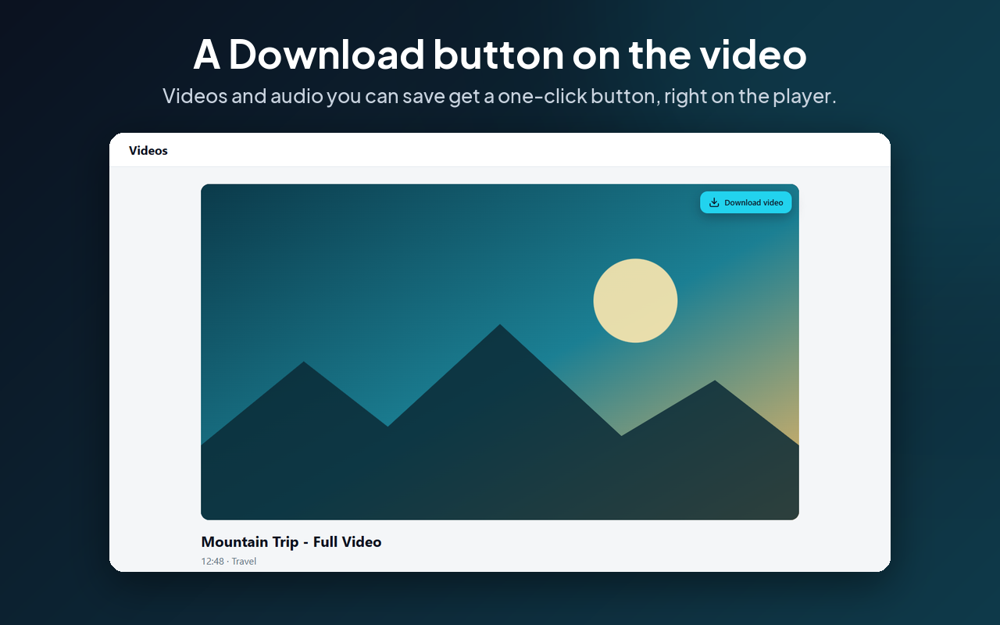
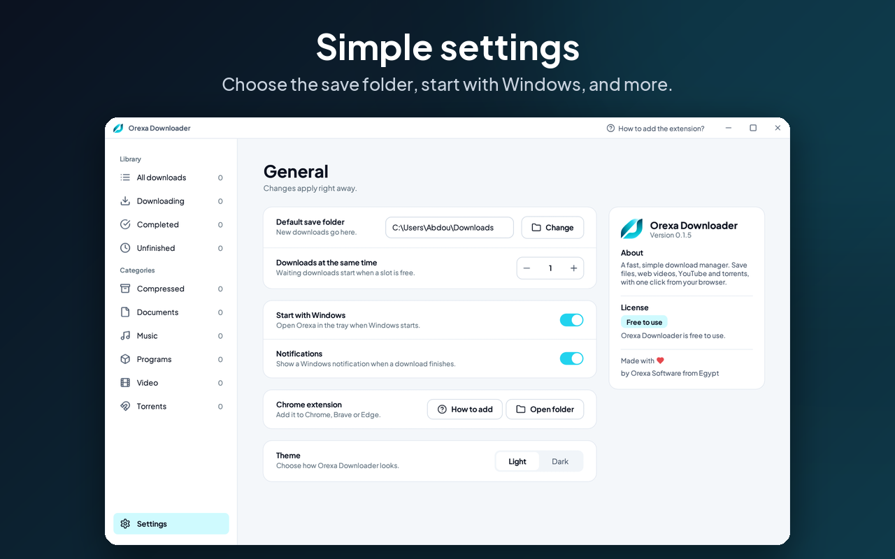
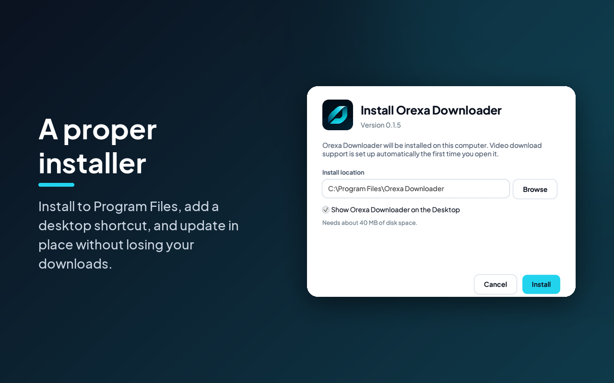

<p align="center">
  
</p>

<h1 align="center">Orexa Downloader</h1>

<p align="center">
  <b>Fast downloads for Windows.</b><br>
  Files, videos and torrents, with one click from your browser.
</p>

<p align="center">
  <a href="https://github.com/abdelrahmanmegaly-jpg/orexa-downloader/releases/latest/download/Orexa-Downloader-Setup.exe"><b>⬇ Download the installer for Windows</b></a>
  &nbsp;·&nbsp;
  <a href="https://github.com/abdelrahmanmegaly-jpg/orexa-downloader/releases/latest">All releases</a>
  &nbsp;·&nbsp;
  <a href="https://orexa.app">orexa.app</a>
</p>

<p align="center">
  
  
  
</p>



## What it does

Orexa Downloader is a download manager. You keep browsing as usual; when you click a download, play a
video, or open a magnet link, Orexa takes it over, downloads it faster, and keeps it organized.

- **Faster downloads.** Big files are split across several connections at once. Pause, resume, queue,
  and carry on after closing the app.
- **Videos.** YouTube and Facebook videos (reels, watch and video links), plus HLS and DASH streams,
  saved as one MP4 with the quality you choose. The video tools (yt-dlp and ffmpeg) are fetched
  automatically in the background the first time they are needed.
- **Torrents.** Magnet links and `.torrent` files, with their own category.
- **Your browser, one click.** A small extension for Chrome, Brave and Edge catches downloads and opens a
  window where you choose *Download now*, *Add to queue* or *Cancel*, and where to save. Play a video and
  a Download button appears on the player.
- **Always ready.** Lives in the system tray, can start with Windows, and shows a notification when a
  download finishes.
- **Made to look good.** Light and dark themes, Arabic text support, and a proper installer that updates
  in place.

## Screenshots

| | |
|---|---|
|  |  |
|  |  |
|  |  |
|  |  |

## Install

1. **[Download `Orexa-Downloader-Setup.exe`](https://github.com/abdelrahmanmegaly-jpg/orexa-downloader/releases/latest/download/Orexa-Downloader-Setup.exe)**
   and run it. Anyone can download it; no account is needed. It installs to Program Files and can add a
   desktop shortcut. Running a newer setup on a PC that already has Orexa updates it in place, keeping
   your downloads and settings.
2. **Add the browser extension** from the official
   [Chrome Web Store](https://chromewebstore.google.com/detail/lhlfkhkcodflljkapdcpcecapmncjfeh)
   (it works in Chrome, Brave and Edge). After installing Orexa, your browser may already ask whether to
   turn it on: choose **Enable**. Otherwise click **How to add the extension?** in the app's title bar.

Requirements: Windows 10 or 11 (64-bit) and about 40 MB of disk space. The first video download also
needs an internet connection to fetch the video tools.

> **About the Windows warning.** The installer is not code-signed yet, so Windows SmartScreen may show
> "Windows protected your PC" with an unknown publisher. Choose **More info → Run anyway**. Each release
> lists the installer's SHA-256 so you can check the file you downloaded.

## How it works

```
 Browser extension  ──native messaging──▶  Orexa Downloader (Rust)  ──▶  files on disk
 (Chrome/Brave/Edge)                        ├─ multi-connection engine
                                            ├─ yt-dlp + ffmpeg  (videos, streams)
                                            └─ librqbit         (torrents)
```

The extension hands each link, with the page's cookies and referrer, to the app through a native
messaging connector that only accepts requests from the Orexa extension. Everything stays on your
computer; nothing is sent to us.

## Build from source

Requirements: Windows 10/11, [Rust](https://rustup.rs) (stable), PowerShell, Python 3 and Node.js (for
the extension packaging and tests).

```powershell
# The app and the installer  ->  dist\Orexa-Downloader-Setup.exe
powershell -ExecutionPolicy Bypass -File .\build-installer.ps1

# The extension zip for the Chrome Web Store  ->  dist\Orexa-Downloader-Extension-<version>.zip
python package-extension.py
```

The version number lives in one place, `extension/manifest.json`. The build copies it into the app and
the installer, so all three always match.

Run the tests:

```powershell
cd app; cargo test --release        # app tests
cd ..;  node extension/tests/logic.test.mjs
        node extension/tests/dialog-logic.test.mjs
```

## Project layout

| Folder | What is in it |
|---|---|
| [`app/`](app) | The Windows app (Rust, eframe/egui): download engine, video and torrent support, tray, browser connector |
| [`setup/`](setup) | The installer / uninstaller wizard (Rust) |
| [`extension/`](extension) | The Manifest V3 browser extension and its tests |
| [`docs/`](docs) | Pictures used in this README |

## Privacy

Orexa Downloader does not collect your data and has no account, analytics or ads. See the
[privacy policy](https://orexa.app/privacy).

## License

[MIT](LICENSE) © Orexa Software. Third-party software is listed in
[`THIRD-PARTY-NOTICES.md`](THIRD-PARTY-NOTICES.md).

---

<p align="center">Made with ❤ by Orexa Software from Egypt.</p>
